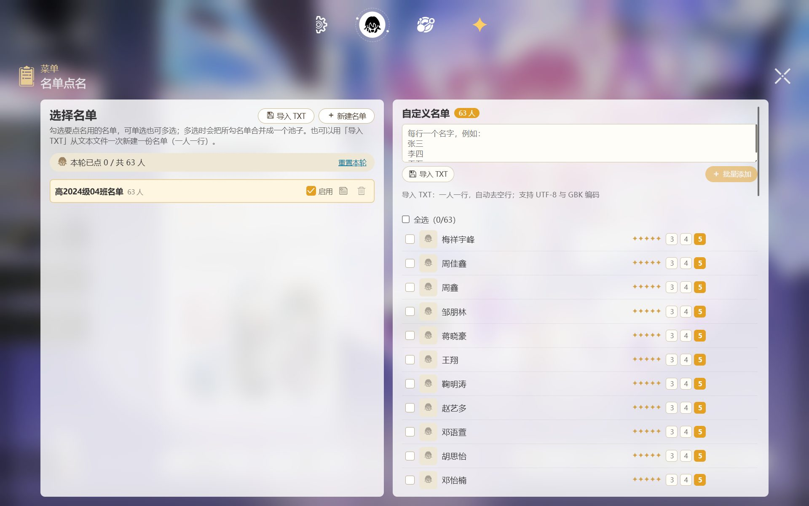

# 星穹铁道跃迁模拟器（点名版） — 崩坏：星穹铁道风格的抽卡模拟 + 自建名单点名工具

界面全中文、完全离线可用的跃迁模拟器。在还原游戏抽卡演出与保底机制的基础上，新增「名单点名」玩法：导入或自建一份名单（同学、同事、抽奖名单皆可），用跃迁演出随机点人。

- 完整复刻游戏跃迁演出：列车入场、逐张揭示、五星专属动画
- 名单点名：自建名单 / 导入 TXT，勾选启用后在点名卡池抽取，可为每人设星级与头像
- 完全离线：不联网、不收集任何个人信息，名单与记录只存在你自己的设备上
- 三平台：Windows 安装版 / 便携版 / 安卓版

> 本项目为开源项目 [HSR Warp Simulator](https://github.com/Mantan21/HSR-Warp-Simulator)（MIT）的中文修改版。游戏素材与名称版权归 miHoYo / HoYoverse 所有，本项目不用于任何商业用途。

## 截图

| 主跃迁页 | 点名卡池 |
|---|---|
|  |  |

| 名单编辑器 |  |
|---|---|
|  |  |

上游英文界面预览（缩小展示）：

| 卡池详情 | 切换卡池 |
|---|---|
|  |  |

| 搜集（库存） | 商店 |
|---|---|
|  |  |

## 功能特性

**跃迁模拟**

1. 全部卡池类型：新手、常驻、角色活动、光锥活动
2. 与游戏接近的保底机制（详见下方概率表）
3. 每个卡池独立的跃迁详情与历史记录
4. 同类型卡池共享保底，跨版本连续抽卡不清空进度
5. 抽卡里程碑奖励，可在商店兑换星轨专票
6. 结果可截图保存为图片，或生成分享链接

**名单点名（本版新增）**

7. 自建名单或导入 TXT（一人一行，行尾加空格和 3/4/5 可指定星级；支持 UTF-8 与 GBK 编码）
8. 多名单管理：新建、重命名、删除、勾选启用，多名单可合并成一个池抽取
9. 名单编辑器：设星级、设头像图标、多选批量操作（批量删除 / 设星级 / 设图标）
10. 点名规则公平：十连内同一个人不会重复被点，星级只作展示、不影响概率
11. 名单与图标只存本机（明文文件，分类子目录），不上传任何地方

**其他**

12. 界面全中文，含关于页与更新日志页
13. 数据全部以明文文件保存在程序目录（Windows）或应用外部目录（安卓），清除/重置由你手动操作
14. 安卓版横屏全屏运行，截图与备份直存系统下载目录

## 保底与概率

概率算法沿用上游实现：`baseRate + ((CurrentPity - HardPity) * additionalRate)`，其中 `additionalRate = (100% - baseRate) / (HardPity 到 MaxPity 的差值)`。实现见 [probabilities.js](src/lib/helpers/gacha/probabilities.js)。

1. 角色活动 / 常驻跃迁的五星概率：基础 `0.6%`，第 74 抽开始递增，第 90 抽必出；限定五星在第 180 抽保底

   | **保底** | ≤73 | 74 | 75 | 76 | 77 | 78 | 79 | 80 | 81 | 82 | 83 | 84 | 85 | 86 | 87 | 88 | 89 | ≥90 |
   | -------: | :--: | :---: | :---: | :----: | :----: | :----: | :----: | :----: | :----: | :----: | :----: | :----: | :----: | :----: | :----: | :----: | :----: | :--: |
   | **概率** | 0.6% | 6.45% | 12.3% | 18.14% | 23.99% | 29.83% | 35.68% | 41.53% | 47.38% | 53.22% | 59.07% | 64.92% | 70.76% | 76.61% | 82.46% | 88.30% | 94.15% | 100% |

2. 光锥活动跃迁的五星概率：基础 `0.8%`，第 63 抽开始递增，第 80 抽必出；限定光锥在第 160 抽保底

   | **保底** | ≤62 | 63 | 64 | 65 | 66 | 67 | 68 | 69 | 70 | 71 | 72 | 73 | 74 | 75 | 76 | 77 | 78 | 79 | ≥80 |
   | -------: | :--: | :---: | :----: | :----: | :----: | :----: | :----: | :----: | :----: | :----: | :----: | :----: | :----: | :----: | :----: | :----: | :----: | :--: |
   | **概率** | 0.8% | 6.31% | 11.82% | 17.33% | 22.84% | 28.35% | 33.86% | 39.38% | 44.88% | 50.40% | 55.91% | 61.42% | 66.93% | 72.44% | 77.95% | 83.47% | 88.98% | 94.49% | 100% |

3. 四星概率：角色活动 `5.1%`、光锥活动 `6.6%`，均为第 10 抽必出四星、第 20 抽必出提升对象
4. 五星与四星同时触发保底时，下一次优先出五星，四星保底顺延到第 11 抽：

   

## 下载与安装

| 平台 | 文件 | 安装方式 |
|---|---|---|
| Windows 10/11 64 位 | `hsr-warp-roll-richkobe-<版本>-windows-x64-setup.exe` | 双击安装；未做代码签名，系统拦截时点「更多信息 → 仍要运行」 |
| Windows 10/11 64 位 | `hsr-warp-roll-richkobe-<版本>-windows-x64-portable.zip` | 解压后双击 exe 即用，免安装 |
| Android 7.0+ | `hsr-warp-roll-richkobe-<版本>-android-arm64.apk` | 允许「安装未知来源应用」后安装；包名 `com.richkobe.hsrwarproll` |

下载地址见 [Release 页](https://github.com/yibanm/HSR-Warp-Simulator-richkobe/releases)。Windows 需系统自带的 WebView2 运行时（Windows 11 与较新的 Windows 10 已内置）。覆盖安装不会清除已有的名单与抽卡记录；安卓版与电脑端数据互不相通。

## 使用说明

1. 首次打开会显示版本公告，点「加载模拟器」进入
2. 抽卡：主界面右下角「跃迁1次 / 跃迁10次」；左上角时钟图标可看往期卡池
3. 点名：顶部菜单第二个图标进入「名单点名」，勾选要用的名单后在点名卡池抽取
4. 建名单：名单管理页「新建名单」逐条添加，或「导入 TXT」一次导入（一人一行）
5. 设图标：名单编辑器里点条目左侧头像换图；多选后可批量设图标 / 星级 / 删除
6. 保存截图：结果页下方保存按钮会弹出系统保存框，由你选择保存位置

## 从源码构建

需要 Node 22+（Capacitor CLI 要求）与 pnpm 9（`packageManager` 已钉版）。

```bash
pnpm install
pnpm dev          # 开发服务器
pnpm build        # 静态站点产物到 build/
npx tauri build   # Windows 桌面壳（需 Rust 工具链）
```

安卓版：`npx cap sync android` 后在 `android/` 下 `./gradlew assembleRelease`；release 签名配置见 `android/key.properties`（本地文件，不入库）。

## 项目结构

```
src/
  routes/          页面：跃迁(_warp)、菜单(_menu)、点名(Rollcall/编辑器)
  lib/helpers/     抽卡概率、名单抽取(rollcall/)、音效、文件存储适配(file-store)
  lib/data/        角色/光锥/卡池数据与中文语言包
android/           Capacitor 安卓壳（含直存 Download 的自研插件）
src-tauri/         Tauri Windows 壳与 NSIS 安装器配置
```

## 常见问题

**完全没有声音？** 先检查 Windows 音量合成器：WebView2 是独立音频会话，可能被单独静音（右键喇叭 → 打开音量合成器 → 找到 WebView2 取消静音）。应用内音量滑块在菜单设置里。

**名单导入后是乱码？** TXT 支持 UTF-8 与 GBK 两种编码，仍乱码请转成 UTF-8 再导入。

**数据存在哪里？** 全部在本机明文文件：Windows 为程序所在文件夹 data/ 目录（config/gacha/rollcall 子目录），安卓为 /storage/emulated/0/Android/data/<包名>/files/hsr-data/，不联网上传。

## 许可证

源码遵循 MIT 协议（继承上游）。游戏素材与名称版权归 miHoYo / HoYoverse 所有，本项目不用于任何商业用途；复用本仓库素材时请一并注明素材来源。
